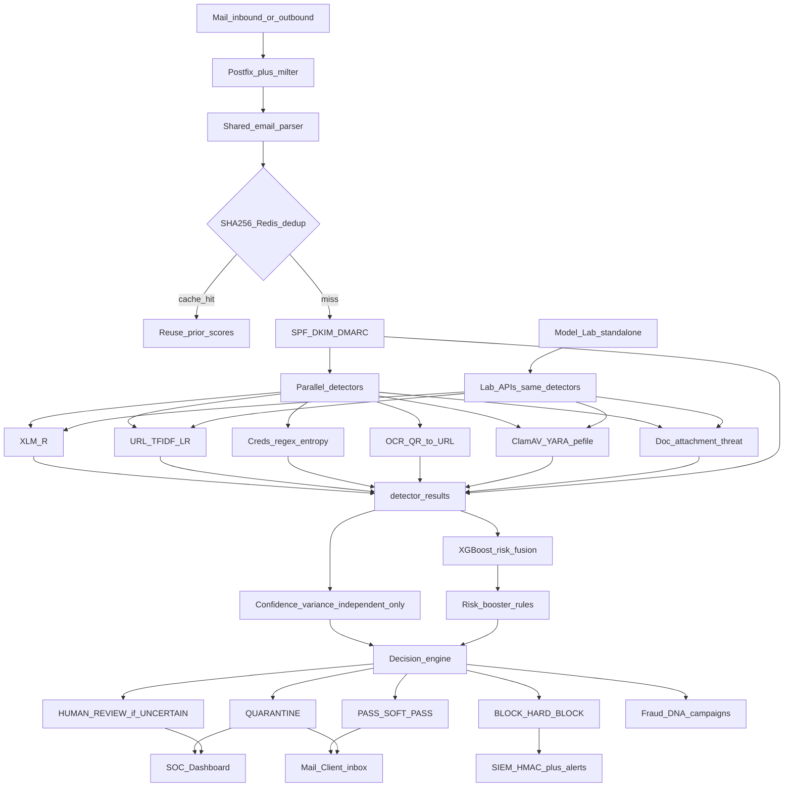

# Guardian AI — Final Execution Plan (Build Order of Record)

**Version:** 1.0  
**Audience:** Two-person team building from zero (one platform builder, one ML trainer)  
**Scope of this file:** Documentation only — the step-by-step build bible. No code is written by this document.

---

## 0. How to use this document

| Document | Role | Edit status |
|---|---|---|
| **This file** (`Guardian_AI_Final_Execution_Plan.md`) | Build order of record, installs, deps, phases, team split, Adds/Upgrades | **Source of truth for what to build when** |
| `Guardian_AI_Build_Plan (1).md` | Product vision, folder tree, team roles, stretch roadmap | **Keep as-is — do not edit** |
| `Guardian_AI_Technical_Specification.md` | DB schema, API contracts, confidence math, Hinglish/eval | **Keep as-is — do not edit** |

**Reading order**

1. This file (what to install, who does what, phase order).  
2. Technical Spec (exact tables, detector I/O shape, confidence formula, eval).  
3. Build Plan (folder layout §6, role table §7, Tier-2 product ideas).

**Conflict rule (locked)**

- Wherever `Guardian_AI_Build_Plan (1).md` Phase 5 says one XGBoost module outputs both risk **and** CONFIDENT/UNCERTAIN, **ignore that**.  
- Follow **Technical Spec §3** + this file:  
  - **Confidence** = disagreement across **independent** detectors only.  
  - **XGBoost** = risk fusion only. It must **never** vote on confidence.

---

## 1. Final verdict on the idea

**Verdict: build it — the thesis is sound and demos well.**

Treat phishing as multiple independent pieces of evidence. If those signals agree, auto-decide with a fused risk score. If they conflict, send to a human. That is clearer, more explainable, and more paper-friendly than a single black-box classifier.

**Attachment gap closed in this Final Plan:** signature malware (ClamAV/YARA) plus Document Attachment Threat Engine (§7.12) for malicious/corrupted PDF and Office files.

**What Guardian already got right (keep using BP + TS)**

- Parallel detectors (text, URL, credentials, image/QR, malware, sender auth).  
- Quarantine + analyst dashboard.  
- Fraud DNA / campaign clustering (upgrade of simple campaign correlation).  
- Hinglish dataset + evaluation methodology (paper strength).  
- Clear `detector_results` contract so people can build in parallel.

**Main risk: scope creep**

Cloud Graph/Gmail, BEC Isolation Forest, VirusTotal/WHOIS as core, URL rewrite, auto-remediation, honeypot, and Red Team AI are valuable but will sink a two-person v1 if built first.

**Locked scope**

| Tier | Build when | Includes |
|---|---|---|
| **Tier 1 (v1)** | Now — Phases 0–11 | SMTP gateway, dedup, all core detectors, independent confidence, XGBoost risk, risk booster, HARD_BLOCK, inbound+outbound+DLP, quarantine/review/explainability, **Mail Client + SOC Dashboard + Model Lab**, Fraud DNA, SIEM/HMAC, alerting, audit, RBAC, rate limit, Docker/Nginx/TLS, E2E |
| **Tier 2 (roadmap)** | Phase 12 only after Tier 1 green | Graph/Gmail, WHOIS/VT feeds, URL rewrite, BEC graph, auto-remediation, honeypot, Red Team, CAPTCHA/CAPEv2 stretch |

---

## 2. What we are building (one sentence)

An AI-powered **SMTP security gateway** that intercepts inbound and outbound mail, runs independent detectors, fuses risk with XGBoost, forces **UNCERTAIN** cases to humans, and exposes **two frontends**: a mail-client-style UI for the SMTP demo and an SOC dashboard with a **standalone Model Lab** to reuse detectors on text/URL/files.

### Tier 1 feature checklist (build these)

1. Postfix + milter interception  
2. SPF / DKIM / DMARC  
3. SHA-256 content dedup + Redis  
4. XLM-R multilingual phishing (trained)  
5. XGBoost risk fusion (trained)  
6. Credential regex + Shannon entropy (+ trusted-sender OTP allowlist)  
7. URL TF-IDF + Logistic Regression (trained)  
8. Image OCR + QR decode → same URL model  
9. ClamAV + YARA + pefile attachment scan (signature / binary malware)  
10. **Document attachment threat engine** — PDF/Office macros, structural malice, corruption/MIME mismatch + trainable structural classifier  
11. Cross-signal confidence (independent signals only)  
12. Risk engine + risk booster  
13. Decision engine + UNCERTAIN → human review  
14. Inbound enforcement  
15. Outbound scan + DLP policy engine  
16. Quarantine + split human-review queues  
17. Explainability (evidence + disagreements + XGBoost contributions)  
18. **Mail Client frontend** — webmail-style UI for the SMTP demo (Inbox / Sent / Quarantine / Compose)  
19. **SOC Dashboard frontend** — threat monitoring, quarantine review, campaigns, explainability  
20. **Model Lab (standalone)** — reuse the same models to scan text / URL / file / .eml without full SMTP  
21. Fraud DNA + campaign clustering  
22. SIEM events signed with HMAC-SHA256  
23. Security alerting (email/webhooks)  
24. Audit logging  
25. JWT + RBAC (viewer / analyst / admin / demo `user` for mail client)  
26. Redis sliding-window rate limiting  
27. Celery + Redis async  
28. PostgreSQL system of record  
29. FastAPI + Nginx + TLS 1.3  
30. Docker Compose packaging  

### Explicitly not Tier 1

M365 Graph / Gmail API, BEC Isolation Forest, VirusTotal/WHOIS as required path, URL click-time rewrite, IdP force-logout, honeypot, Red Team AI, CAPTCHA rendering, CAPEv2 sandbox (dynamic detonation stays Phase 12).

**Attachment coverage note:** ClamAV/YARA alone is **not** enough for malicious or corrupted PDFs/Office docs. Tier 1 requires the Document Attachment Threat Engine (§7.12, Phase 3G) in addition to signature scanning.

**Frontend coverage note:** Build Plan lists a single SOC dashboard. This Final Plan requires **two** React apps (§7.13): Mail Client + SOC Dashboard with Model Lab.

---

## 3. Two-person team split

### Person A — Platform builder (entire product)

Owns: Docker, Postgres, Redis, FastAPI, Celery, Postfix/milter, parser, dedup, detector **loading/serving**, confidence, risk booster, decision, DLP, quarantine, review APIs, **both React frontends (Mail Client + SOC Dashboard/Model Lab)**, mailbox + lab APIs, SIEM, alerting, audit, RBAC, rate limit, Nginx/TLS, E2E harness, **oletools / PDF structural analyzers** (deterministic half of doc attachment engine).

Does **not** train models. Loads versioned artifacts Person B hands over.

### Person B — ML trainer (models only)

Owns: datasets, training notebooks/scripts, eval tables, version tags, and **four** Tier-1 artifacts:

| # | Model | Train? | Artifact to hand to A |
|---|---|---|---|
| 1 | URL — char TF-IDF + Logistic Regression | **Yes** | `url_tfidf_logreg.joblib` (+ vectorizer) |
| 2 | Text — XLM-RoBERTa-base fine-tuned | **Yes** | HF model dir + tokenizer + `model_version` |
| 3 | Document structural classifier — Random Forest or Logistic Regression on PDF/Office features | **Yes** | `models/doc_struct/v1/doc_struct_clf.joblib` |
| 4 | Risk fusion — XGBoost | **Yes** | `xgb_risk_fusion.ubj` / `.json` + ordered feature list |

Also calibrates (with A): confidence variance threshold and decision score cutoffs on a shared labeled set.

**Not trained (Person A implements as engines)**

| Engine | Why no training |
|---|---|
| Regex + entropy credentials | Deterministic patterns |
| SPF/DKIM/DMARC | DNS / crypto checks |
| Tesseract OCR + QR decode | Pretrained / decode only |
| ClamAV / YARA / pefile | Signatures / rules |
| oletools / PDF structural flags / MIME-mismatch / corrupt-parse heuristics | Deterministic analyzers (feed features into model #3) |
| Confidence variance | Threshold tuning only |
| Risk booster / DLP | Rules |
| ssdeep/TLSH + sentence-transformers | Use pretrained embeddings; fuzzy hash is not ML train |
| Isolation Forest BEC | **Tier 2 only** |
| Deep CNN / raw-byte PDF neural nets | **Out of scope for v1** (too heavy; use structural features instead) |

### Handoff contract (locked)

```text
Person B trains URL model, XLM-R, and doc_struct classifier independently (no gateway required for URL/XLM-R;
  doc_struct needs feature extractor shared with A — agree feature schema early).
Person A builds pipeline that writes detector_results (raw_score 0..1), including doc_attachment_threat.
Person A exports feature CSV for labeled emails (or shared fixture runner).
Person B trains XGBoost on that feature schema + labels (includes doc_struct_score).
Person A loads all four artifacts; never uses XGBoost for CONFIDENT/UNCERTAIN.
```

**Recommended parallel timeline**

1. Week 0–1: A = Phase 0–1; B = download datasets + start URL model.  
2. Week 1–3: A = Phase 2–3 (stub ML OK; build oletools/PDF feature extractors); B = finish URL + fine-tune XLM-R + start doc_struct.  
3. Week 3–4: A emits fusion features (incl. `doc_struct_score`); B finishes doc_struct + trains XGBoost; both tune thresholds.  
4. Week 4+: A Phases 4–11; B supports eval / Hinglish metrics / doc-struct metrics / model_versions rows.

---

## 4. Pre-flight — install BEFORE writing project code

Do this once as a team before Phase 1.

### 4.1 Host tools

| Tool | Why | Check |
|---|---|---|
| Git | Source control | `git --version` |
| Docker Desktop (or Engine + Compose) | Postgres, Redis, Postfix, ClamAV, app | `docker compose version` |
| Python 3.11+ | Backend + ML | `python --version` |
| Node.js 20+ and npm | Both React frontends (mail-client + dashboard) | `node -v` / `npm -v` |
| VS Code (or equivalent) | Editor | — |

**Windows note:** Postfix + pymilter belong **inside Linux containers**. Develop the gateway path in Docker even if the host is Windows.

### 4.2 System packages (or Compose images)

| Package | Why |
|---|---|
| `tesseract-ocr` | OCR for images in mail |
| `libzbar0` / zbar | QR decode (`pyzbar`) |
| ClamAV daemon | Attachment malware scan |
| YARA | Custom malware rules |

### 4.3 Accounts / keys

| Item | When needed |
|---|---|
| Test domain + SPF/DKIM/DMARC DNS | Phase 2 testing |
| VirusTotal / Azure / Google Cloud | **Tier 2 only** — do not block Tier 1 |

### 4.4 Datasets (Person B downloads early)

| Dataset | Use |
|---|---|
| Nazario phishing corpus | XLM-R positive class |
| SpamAssassin public corpus | XLM-R negative / legit |
| SpamShield (Hinglish subset) | Multilingual eval / fine-tune |
| PhishTank + URLhaus | URL model malicious |
| Tranco / Common Crawl domains | URL model benign |
| EICAR test file only | Malware smoke test (never live malware on a laptop) |
| Benign PDF/Office samples + public doc-malware **feature** datasets (or carefully isolated labeled docs) | Document structural classifier (Person B) |
| Enron | Tier 2 BEC baseline only |

### 4.5 Machine expectations

| Work | Hardware |
|---|---|
| URL LogReg + XGBoost train | CPU laptop is fine |
| XLM-R fine-tune | Prefer GPU (8GB+ VRAM); CPU possible but slow |
| Inference demo | CPU acceptable for low volume |

---

## 5. Dependencies and model compatibility

### 5.1 Backend / platform (Person A)

- Python 3.11+, FastAPI, Uvicorn/Gunicorn, Pydantic  
- SQLAlchemy, Alembic, asyncpg/psycopg  
- Celery, redis  
- PyJWT / python-jose, passlib[bcrypt]  
- pymilter (in Linux container), pyspf, dkimpy, checkdmarc, dnspython  
- httpx, python-multipart, email-parser stack as needed  

### 5.2 ML inference + training

| Lib | Who uses | Purpose |
|---|---|---|
| torch + transformers | B train / A infer | XLM-R |
| scikit-learn, joblib | B train / A infer | URL TF-IDF+LR **and** doc structural classifier |
| xgboost | B train / A infer | Risk fusion |
| numpy, pandas | Both | Features / eval |
| sentence-transformers | A (+ B eval) | Fraud DNA embeddings |
| ssdeep or TLSH | A | Fuzzy body hash |
| pytesseract, opencv-python, pyzbar | A | Image/QR |
| yara-python, pefile, clamd client | A | Signature malware (ClamAV/YARA) |
| oletools | A (+ B feature dump) | Office macros / VBA static analysis |
| pypdf and/or pdfminer.six | A (+ B feature dump) | PDF structural flags (JS, OpenAction, embedded files) |

### 5.3 Frontend (Person A)

**Two** React + TypeScript + Vite + Material UI apps (Recharts on the SOC app):

| App | Path | Purpose |
|---|---|---|
| Mail Client | `frontend/mail-client/` | Webmail-looking SMTP demo (Inbox / Sent / Quarantine / Compose) |
| SOC Dashboard + Model Lab | `frontend/dashboard/` | Ops monitoring + standalone detector reuse (text / URL / file / .eml) |

Both share the same FastAPI backend and JWT auth. Models are loaded once on the backend — frontends never embed Person B artifacts.

### 5.4 Deploy

- Docker Compose, Nginx, TLS 1.3, PostgreSQL 15+, Redis 7+

### 5.5 Compatibility matrix (models vs pipeline)

| Component | Role | Independent for confidence? | Feeds XGBoost risk? | Compatible? |
|---|---|---|---|---|
| XLM-R | Semantic phishing | **Yes** | Yes (as one feature) | Yes — never treat as peer of XGBoost for agreement |
| XGBoost | Risk fusion | **No** | Is the fusion | Yes — risk only |
| TF-IDF + LogReg | Malicious URLs | **Yes** | Yes | Yes — QR/OCR URLs reuse this same model |
| Regex + entropy | Credentials / secrets | **Yes** | Yes | Yes — pair with OTP allowlist |
| SPF/DKIM/DMARC | Sender auth | **Yes** | Yes | Yes |
| ClamAV/YARA/pefile | Signature / binary malware | **Yes when applicable** | Yes | Yes — high weight when fires; complementary to doc engine |
| Doc attachment threat (rules + structural ML) | Malicious/corrupt PDF/Office | **Yes when attachments present** | Yes (`doc_struct_score`) | Yes — independent of XLM-R/URL/creds/auth; not a CNN |
| OCR/QR | Extractors only | Indirect | Via URL/text scores | Yes — not a second URL classifier |
| Confidence (variance) | CONFIDENT / UNCERTAIN | N/A | No | Yes — uses independent scores only |
| Fraud DNA | Post-decision intel | No | Optional later boost | Yes — after QUARANTINE/BLOCK |
| Isolation Forest | BEC Tier 2 | Yes when built | Yes | Park until Phase 12 |
| CAPEv2 sandbox | Dynamic detonation | — | — | Phase 12 stretch only |

**Known pitfalls**

- XGBoost consuming XLM-R score means “XLM-R vs XGBoost disagreement” is meaningless — do not implement that.  
- Do **not** treat ClamAV alone as covering PDF/Office macros or corrupted documents — use Phase 3G.  
- Windows host cannot run pymilter natively — use Docker.  
- `pytesseract` needs the **system** Tesseract binary.  
- Torch wheels must match Python 3.11.  
- Celery broker URL must point at the same Redis Compose service.  
- Never train or detonate live malware on a personal laptop; use feature datasets + isolated fixtures.

---

## 6. Architecture of record



**UI routing (locked)**

```text
Mail Client   →  /api/v1/mailbox/*     →  DB + compose/send via gateway
SOC Dashboard →  /api/v1/threats|quarantine|campaigns|…
Model Lab     →  /api/v1/lab/text|url|file|eml  →  same detector modules as Celery
```

### Decision table (locked)

| `fused_risk_score` (0–100) | `confidence_state` | Decision |
|---|---|---|
| 0–20 | CONFIDENT | PASS |
| 21–45 | CONFIDENT | SOFT_PASS |
| 46–70 | CONFIDENT | QUARANTINE |
| 71–90 | CONFIDENT | BLOCK |
| 91–100 **or** malware/signature confirmed **or** critical doc threat (auto-exec macro / confirmed malicious structure) **or** outbound critical secret policy | CONFIDENT | HARD_BLOCK |
| Any | UNCERTAIN | HUMAN_REVIEW |

**Rules**

- UNCERTAIN always overrides the score bucket.  
- Fail-closed: if fusion/confidence service is down → **QUARANTINE** (not PASS).  
- Outbound DLP may force QUARANTINE / BLOCK / HARD_BLOCK even when phishing risk is low.

### Confidence vs risk (locked)

1. Normalize each applicable detector `raw_score` to 0.0–1.0 (Technical Spec §2.2).  
2. **Confidence:** variance/std of independent detectors (XLM-R, URL, creds, auth, malware-if-applicable, **doc_attachment_threat-if-applicable**). High variance → UNCERTAIN.  
3. **Risk:** XGBoost (or weighted fallback) → 0–100.  
4. **Risk booster:** rules (e.g. high XLM-R + credentials → escalate; ClamAV hit or auto-exec macro → HARD_BLOCK).  
5. **Decision:** table above.

---

## 7. Gap closure — Adds (write into the build; not in old MDs)

Implement these even though Guardian MDs stay unchanged.

### 7.1 Content deduplication

- Compute SHA-256 over normalized body (+ optional attachment hash set).  
- Store in Redis with TTL.  
- On hit: reuse prior `detector_results` / decision path; skip heavy ML.

### 7.2 Risk booster

Rule layer after XGBoost, before decision. Examples:

- Phishing score high **and** credentials detected → bump toward QUARANTINE/BLOCK.  
- Malware signature hit (ClamAV/YARA) → force HARD_BLOCK.  
- Outbound private key / AWS key match → HARD_BLOCK.  
- Office auto-exec macro **or** PDF `/Launch`/`/JavaScript` with high `doc_struct_score` → escalate to BLOCK/HARD_BLOCK.  
- Unreadable/truncated/corrupt attachment parse **and** MIME mismatch → escalate at least to QUARANTINE.

### 7.3 HARD_BLOCK

Distinct from BLOCK: confirmed malware signature, **critical document threat** (auto-exec macro / confirmed malicious PDF structure), critical outbound leak, or admin policy. Triggers strongest alert + SIEM severity.

### 7.4 Outbound DLP policy engine

- Org rules on credential/secret classes.  
- Actions: allow / quarantine / block / hard_block.  
- Inbound OTP from authenticated banks/IdPs can be allowlisted; outbound of the same patterns is not.

### 7.5 Trusted-sender OTP allowlist

- If SPF/DKIM/DMARC pass **and** sender domain ∈ allowlist (e.g. bank/IdP) **and** only OTP-like pattern → do not inflate inbound risk.  
- Never apply this allowlist to outbound.

### 7.6 SIEM + HMAC-SHA256

- Emit structured JSON events (decision, scores, email_id, timestamp).  
- Sign payload with HMAC-SHA256 shared secret.  
- Deliver via webhook.

### 7.7 Security alerting

- Email and/or webhook on HARD_BLOCK, credential leak, campaign `escalating`.

### 7.8 Audit logs

Postgres `audit_logs`: actor_id, role, action, email_id, before/after JSON, timestamp. Every analyst override and admin policy change.

### 7.9 RBAC

Roles: `viewer` (read), `analyst` (release/block/mark FP + Model Lab), `admin` (policies, users, thresholds), `user` (Mail Client mailbox only).

### 7.10 Rate limiting

Redis sliding window on API (and protect workers from milter floods).

### 7.11 Schema deltas (apply when coding; TS stays as written)

Add when implementing:

- `emails.content_hash_sha256`  
- `audit_logs`  
- `dlp_policies`  
- `users` / roles  
- `siem_events` or outbox  
- Treat `ingestion_path` for Tier 1 as `milter`; extend to `graph` / `gmail` only in Tier 2  
- Extend `detector_results.detector_name` enum with **`doc_attachment_threat`** (TS lists `malware_scan` only — implement both: signatures vs document structure)

### 7.12 Document Attachment Threat Engine (Tier 1 — closes PDF/DOC gap)

**Gap this closes:** ClamAV + YARA + pefile catch known signatures and many binaries; they do **not** fully cover malicious or corrupted **PDFs, Word/Excel/PowerPoint**, macro-laced Office files, PDF JavaScript/OpenAction lures, MIME/extension mismatch, or truncated/polyglot attachments. Tier 1 therefore adds a dedicated engine.

**Detector name:** `doc_attachment_threat` (one Spec-shaped `detector_results` row per email when any attachment is present; else `not_applicable`).

**Layer A — Deterministic analyzers (Person A)**

| Attachment family | Checks |
|---|---|
| Office (DOC/DOCX/XLS/XLSX/PPT/…) | `oletools` / olevba: macros present, auto-exec indicators, suspicious VBA keywords |
| PDF | Structural flags via `pypdf` and/or `pdfminer.six` (and pdfid-style counts): `/JavaScript`, `/OpenAction`, `/Launch`, embedded files, encryption anomalies |
| Generic | Declared MIME vs extension mismatch; parse failure / truncated file; polyglot hints; extreme stream entropy |

**Layer B — Trainable model #4 (Person B): Document Structural Classifier**

- Algorithm: **Random Forest or Logistic Regression** on engineered structural features (not a raw-byte CNN).  
- Example features: `macro_present`, `autoexec_flag`, `pdf_js_count`, `open_action_flag`, `embedded_file_count`, `stream_entropy_mean`, `object_count`, `mime_mismatch`, `parse_error`, `file_size`, `encryption_flag`.  
- Labels: malicious vs benign Office/PDF (public feature corpora and/or carefully isolated samples — never detonate live malware on a laptop).  
- Artifact: `models/doc_struct/v1/doc_struct_clf.joblib`.  
- Roles: **independent confidence signal** when attachments exist; also XGBoost input `doc_struct_score`.

**How the two layers combine**

1. A extracts features + deterministic verdicts/evidence.  
2. B’s classifier scores the feature vector → `raw_score` 0–1.  
3. Final `doc_attachment_threat` score = max(rule_escalation_score, model_score) or a documented blend; evidence JSON must list which flags fired.  
4. ClamAV/YARA remains a **separate** detector (`malware_scan`) — complementary, not replaced.  
5. CAPEv2 dynamic sandbox stays **Phase 12** stretch.

**Compatibility:** Independent of XLM-R, URL model, credentials, and sender auth → valid confidence voter when applicable.

### 7.13 Dual frontends + standalone Model Lab (Tier 1)

Guardian Build Plan / earlier Final Plan had **one** SOC dashboard. Tier 1 now requires **two** frontends plus lab APIs so models can be reused outside SMTP.

#### Frontend 1 — Mail Client (`frontend/mail-client/`)

- Webmail-style UI: **Inbox**, **Sent**, **Quarantine** folder, message open, **Compose**.  
- Browser talks to FastAPI `/api/v1/mailbox/*` only (not raw SMTP from the browser).  
- Compose/send goes through the gateway/API so messages still hit milter → detectors → decision.  
- PASS/SOFT_PASS mail appears in Inbox; QUARANTINE appears in Quarantine folder (user cannot release — analyst does that in SOC).  
- Auth: JWT; demo role `user` (or mailbox-scoped `viewer`). Local gateway/DB only — **not** Graph/Gmail.

#### Frontend 2 — SOC Dashboard + Model Lab (`frontend/dashboard/`)

**Ops (existing Tier 1 pages)**

- Threat / email list, email detail, dual review queues, campaigns, explainability, RBAC-aware nav.

**Model Lab (standalone reuse — new)**

| Lab action | API | Detectors reused |
|---|---|---|
| Paste text | `POST /api/v1/lab/text` | XLM-R (+ optional fusion if other scores supplied/stubbed) |
| Check URL | `POST /api/v1/lab/url` | URL TF-IDF+LR |
| Upload file | `POST /api/v1/lab/file` | doc_struct + ClamAV/YARA/pefile |
| Upload/paste .eml or raw | `POST /api/v1/lab/eml` | Shared parser → **same pipeline** as milter |

Lab responses must use the same shape as production detectors: `raw_score` 0–1, `verdict`, `explanation`, `evidence`, `model_version`. No second copy of Person B artifacts — load from `models/` once in the API/worker.

#### RBAC note

Roles: `user` (mail client), `viewer`, `analyst`, `admin`. Lab write/scan: `analyst`/`admin` (and optionally `viewer` read-only lab). Mailbox APIs: `user` + elevated roles for support.

---

## 8. Gap closure — Upgrades (corrective vs Build Plan)

| Topic | Upgrade |
|---|---|
| Fusion | Split confidence (TS §3) from XGBoost risk |
| Explainability | Per-detector evidence + list of disagreeing signals + XGBoost feature contributions |
| Human review | Two queues: high-risk confirmed vs UNCERTAIN conflicts |
| Campaigns | Implement via Fraud DNA (ssdeep/TLSH + embeddings) |
| Outbound | Explicit path; different weights/DLP than inbound |
| Attachments | Split signature malware (ClamAV/YARA) from document structural threat (PDF/Office) — both Tier 1 |
| Frontends | Two apps: Mail Client (SMTP demo UX) + SOC Dashboard with standalone Model Lab |

---

## 9. Keep / Park inventory

**Keep from Guardian (use BP/TS as written for these)**  
Detectors list, Fraud DNA idea, malware stack (ClamAV), Hinglish/eval (§5–§7 TS), Compose services, folder tree base. **Document structural ML (§7.12) and dual frontends + Model Lab (§7.13) are Adds in this Final Plan** — implement for Tier 1 even though Build Plan shows a single dashboard.

**Park until Phase 12**  
Graph/Gmail connectors, domain intel feeds as core, URL rewrite, BEC Isolation Forest, auto-remediation, honeypot, Red Team AI, CAPTCHA/CAPEv2, Vault/SOC2 narrative.

---

## 10. Suggested folder structure

Use Build Plan §6. Minimal tree for daily work:

```text
guardian-ai/
  gateway/                 # Postfix + milter
  backend/
    api/
    auth/
    email/                 # shared parser
    detection/
    risk/                  # confidence + xgb risk + booster + decision
    quarantine/
    dlp/
    campaigns/
    fraud_dna/
    siem/
    audit/
    mailbox/               # demo webmail APIs for Mail Client
    lab/                   # standalone scan APIs (text/url/file/eml)
  ai/                      # inference wrappers (A) + training scripts (B)
    phishing/
    url/
    credentials/
    image/
    malware/                 # ClamAV/YARA/pefile wrappers
    doc_struct/              # feature extract + structural classifier (A infer / B train)
    fusion/
  frontend/
    mail-client/             # webmail-style SMTP demo UI
    dashboard/               # SOC ops + Model Lab pages
  database/migrations/
  models/                  # versioned artifacts from Person B
  tests/
  docker/
```

---

## 11. Phased execution plan (spoonfeeding)

Each phase below is ordered. Do not skip checkpoints.

---

### Phase 0 — Team and repo setup

**Goal:** Shared repo and conventions before code.

**What you are building:** GitHub repo, branch protection on `main`, project board mapped to phases, `.env.example`, role assignment (A = platform, B = ML).

**Prerequisites:** Section 4 pre-flight tools installed.

**Install / enable:** Git, GitHub account, project board.

**Implementation steps**

1. Create repo `guardian-ai`.  
2. Protect `main` (PR required).  
3. Commit empty tree + `.env.example` listing: `DATABASE_URL`, `REDIS_URL`, `JWT_SECRET`, `SIEM_HMAC_SECRET`, `MODEL_DIR`, mail test vars.  
4. Assign Person A / Person B.  
5. Create board columns: Phase 0 … Phase 12.

**Verify:** Both can clone; `.env.example` has no real secrets.

**Pitfalls:** Committing real API keys; skipping board so work collides.

**Owners:** Both.

---

### Phase 1 — Foundation skeleton

**Goal:** Prove API + DB + queue before any email logic.

**What you are building:** `docker-compose.yml` with Postgres, Redis, `api`, `worker`; FastAPI `/health`; JWT register/login stub; Alembic; Celery task that writes a row to Postgres.

**Prerequisites:** Phase 0 done.

**Install / enable:** Docker Compose; Python venv; `fastapi`, `uvicorn`, `sqlalchemy`, `alembic`, `celery`, `redis`, `passlib`, JWT lib.

**Implementation steps**

1. Compose services: `postgres`, `redis`, `api`, `worker`.  
2. Alembic init; first migration for a trivial `health_checks` or `users` table.  
3. JWT login/register endpoints.  
4. Celery task `ping_db` enqueued from API.  
5. Internal Docker network only; no public DB ports in final posture (dev may expose for convenience).

**Verify:** Authenticated request queues Celery job; row appears in Postgres.

**Pitfalls:** Celery not using Compose Redis URL; mixing host `localhost` inside containers.

**Owners:** Person A. Person B sets up ML venv in parallel.

---

### Phase 2 — Email ingestion + dedup

**Goal:** Mail becomes structured DB rows.

**What you are building:** Postfix + pymilter container calling backend; shared parser (headers, body plain/HTML, URLs, images, attachments); `emails` (+ urls/attachments) tables; SHA-256 dedup in Redis.

**Prerequisites:** Phase 1 checkpoint green.

**Install / enable:** Postfix image, pymilter (Linux container), DNS test domain for later auth tests.

**Implementation steps**

1. Milter receives message → POST raw/parsed payload to API or enqueue Celery `ingest_email`.  
2. Parser module extracts fields per Technical Spec §2.1.  
3. Compute `content_hash_sha256`; if Redis hit, mark duplicate and skip heavy work later.  
4. Persist `emails`, `email_urls`, `email_attachments`.  
5. Set `ingestion_path = milter`.

**Verify:** Send a test SMTP message; see one structured row in Postgres with URLs extracted.

**Pitfalls:** Parsing only plain text and missing HTML links; hashing non-normalized content so trivial whitespace busts cache.

**Owners:** Person A.

---

### Phase 3 — Individual detectors (isolate, then wire)

**Goal:** Each detector returns Spec-compliant `detector_results`.

Build in this order (simple → hard):

#### 3A Sender authentication

**Build:** SPF/DKIM/DMARC via `checkdmarc` / `dkimpy` / `pyspf`.  
**Verify:** Spoofed From fails; properly signed test passes.  
**Owner:** A.

#### 3B Credentials + OTP allowlist

**Build:** Regex for keys/JWT/OTP/private keys + Shannon entropy; inbound allowlist logic.  
**Verify:** Synthetic email with AWS key flags; allowlisted bank OTP with pass auth does not over-score inbound.  
**Owner:** A.

#### 3C URL model (Person B trains → A serves)

**Person B steps**

1. Collect PhishTank/URLhaus + benign Tranco URLs.  
2. Char n-gram TF-IDF + Logistic Regression; train/val/test split; log Precision/Recall/F1/FPR.  
3. Export `models/url/v1/url_tfidf_logreg.joblib`.  
4. Document version in a `MODEL_CARD.md`.

**Person A steps**

1. Load artifact; score each `email_urls` row; aggregate to email-level `url_model` result.  
2. Write `detector_results` with evidence (which URL, score).

**Verify:** Known phish URL → high score; `google.com` → low.

#### 3D Image / QR

**Build:** OpenCV + Tesseract + pyzbar; extracted URLs go through **same** URL model; OCR text may also feed phishing model later.  
**Verify:** PNG with QR to phishing URL flags via URL model.  
**Owner:** A (uses B’s URL artifact).

#### 3E XLM-R phishing (Person B trains → A serves)

**Person B steps**

1. Build English set (Nazario + SpamAssassin) + Hinglish from SpamShield (TS §5).  
2. Fine-tune `xlm-roberta-base`; stratified splits; report English vs Hinglish metrics (TS §7).  
3. Export `models/phishing/v1/` HF directory + version string.

**Person A steps**

1. Load model for inference (Celery worker; batch size 1 OK for v1).  
2. Write `detector_results` for `xlm_r_phishing`.

**Verify:** Clear phishing body → high; neutral newsletter → low. Include one Hinglish sample if available.

#### 3F Malware scan (signatures / binaries only)

**Build:** ClamAV daemon + YARA rules + pefile/hash; EICAR smoke test.  
**Scope:** Known malware signatures and PE/binary checks — **not** a substitute for PDF/Office macro/structure analysis (that is 3G).  
**Verify:** EICAR attachment → malicious verdict / HARD_BLOCK candidate.  
**Owner:** A.

#### 3G Document attachment threat (PDF / Office / corrupt files)

**Goal:** Detect malicious and corrupted document attachments that signature scanners miss.

**Person A — deterministic layer**

1. Shared feature extractor for each attachment (Office via `oletools`, PDF via `pypdf`/`pdfminer.six`, generic MIME/parse/entropy checks).  
2. Persist evidence (macro flags, JS counts, parse errors, MIME mismatch).  
3. Load Person B’s classifier; write `detector_results` with `detector_name = doc_attachment_threat`.  
4. No attachments → `not_applicable`.

**Person B — trainable structural classifier**

1. Agree feature schema with A (locked list for XGBoost later).  
2. Train Random Forest or Logistic Regression on malicious vs benign PDF/Office structural features.  
3. Export `models/doc_struct/v1/doc_struct_clf.joblib` + feature order + metrics (Precision/Recall/FPR).  
4. Provide safe fixtures: macro-enabled DOC/DOCX sample (lab-only), PDF with `/JavaScript` or `/OpenAction`, truncated/corrupt PDF, clean PDF/DOCX.

**Verify**

- Macro auto-exec Office → high score / booster path toward BLOCK/HARD_BLOCK.  
- PDF with JavaScript/OpenAction → elevated score.  
- Truncated/corrupt PDF + MIME mismatch → QUARANTINE-or-higher path.  
- Clean PDF resume → low score / not over-blocked.  
- ClamAV clean **but** doc engine high is a valid conflict → may be UNCERTAIN or booster-escalated per rules.

**Owners:** A (extractors + serving); B (train model #4).

**Phase 3 checkpoint:** Every detector, given fixtures, writes Spec-shaped rows. Missing modality → `verdict=not_applicable`, not omitted.

**Pitfalls:** Detectors returning unnormalized scores; skipping `not_applicable` rows; training XGBoost before detectors stabilize; relying on ClamAV alone for Office/PDF; training on live malware outside an isolated lab.

---

### Phase 4 — Confidence, risk, booster, decision

**Goal:** One email in → risk + confidence + decision out.

**What you are building**

1. Confidence engine (Technical Spec §3) — variance of independent scores.  
2. XGBoost risk fusion (Person B trains on A’s feature export).  
3. Risk booster rules.  
4. Decision engine with HARD_BLOCK + fail-closed QUARANTINE.

**Person B — XGBoost**

1. Agree feature list with A, e.g.  
   `xlm_r_score, url_max_score, cred_score, auth_fail_score, malware_score, doc_struct_score, url_count, has_attachment, ...`  
2. Build labeled set (phish/legit/conflict/**malicious-doc**).  
3. Train XGBoost; export model + feature order.  
4. With A, tune variance threshold and decision cutoffs on validation set; write chosen numbers into `docs/thresholds.md` (or section in repo README later).

**Person A**

1. Implement confidence module reading only `detector_results`.  
2. Load XGBoost; produce `fused_risk_score` 0–100 + `contributing_detectors`.  
3. Apply booster.  
4. Apply decision table; persist `confidence_scores` + `decisions`.

**Verify**

- Clean mail → CONFIDENT + PASS/SOFT_PASS.  
- Multi-signal phish → CONFIDENT + BLOCK/HARD_BLOCK.  
- Conflict (auth pass + high XLM-R + clean URL) → UNCERTAIN + HUMAN_REVIEW regardless of mid score.

**Pitfalls:** Feeding XGBoost output into confidence; auto-deciding UNCERTAIN; fail-open on errors.

**Owners:** A implements; B trains/calibrates.

---

### Phase 5 — Inbound / outbound enforcement + DLP

**Goal:** Decisions affect mail flow; secrets on outbound are policed.

**What you are building**

- Milter applies decision (deliver / quarantine hold / reject).  
- Outbound path uses credential/DLP-heavy policy.  
- `dlp_policies` CRUD (admin).

**Verify:** Inbound phish blocked from inbox; outbound with pasted private key → HARD_BLOCK/QUARANTINE per policy.

**Pitfalls:** Using inbound OTP allowlist on outbound; silently dropping mail without quarantine record.

**Owner:** A.

---

### Phase 6 — Quarantine, human review, explainability

**Goal:** Analysts can act; “why” is visible.

**What you are building**

- Quarantine storage + list/release/block APIs.  
- Two queues: `HIGH_RISK` vs `UNCERTAIN`.  
- Explainability payload: detector explanations, disagreement list, XGBoost contributions.  
- Analyst actions write `audit_logs` + `analyst_override` on decisions.

**Verify:** UNCERTAIN email appears only in conflict queue; release writes audit row.

**Owner:** A.

---

### Phase 7 — Dual frontends (Mail Client + SOC / Model Lab)

**Goal:** User-facing mail UX and analyst UX; prove models can run standalone.

#### 7A — Mail Client (`frontend/mail-client/`)

**What you are building**

- React webmail: Inbox / Sent / Quarantine, open message, Compose.  
- Backend `/api/v1/mailbox/*`: list/read for demo mailbox; compose enqueues send through gateway so milter still runs.  
- JWT login as demo `user`.

**Verify:** Send clean mail via Compose → appears in Inbox after PASS; send phish fixture → Quarantine folder (not Inbox).

**Pitfalls:** Browser speaking SMTP directly; bypassing milter on compose; letting mail users release quarantine.

#### 7B — SOC Dashboard + Model Lab (`frontend/dashboard/`)

**What you are building (Material UI + TS + Recharts)**

- Threat / email list; email detail (detectors, confidence, risk, decision).  
- Quarantine + dual review queues; campaign placeholder (Phase 8).  
- RBAC-aware nav (`viewer` / `analyst` / `admin`).  
- **Model Lab pages:** text paste, URL check, file upload, .eml upload — calling `/api/v1/lab/*`.  
- Lab uses **same** loaded models as the Celery pipeline (no duplicate artifacts).

Use Technical Spec §2.5 single aggregated email-detail endpoint for ops views.

**Verify**

- Three fixtures in SOC UI (clean / block / uncertain).  
- Lab: malicious URL scores high; clean URL low; text phish flags; uploaded EICAR or doc fixture returns Spec-shaped JSON.

**Pitfalls:** Dashboard issuing five separate queries; Lab loading a second copy of models; Lab skipping `model_version` in responses.

**Owner:** A (both 7A and 7B).

---

### Phase 8 — Fraud DNA + campaigns

**Goal:** Related attacks cluster.

**What you are building**

- On QUARANTINE/BLOCK/HARD_BLOCK: store Fraud DNA (domains, URLs, hashes, techniques, fuzzy hash, embedding).  
- Similarity job clusters into `campaigns`; update `growth_rate_flag`.

**Verify:** Three variant phish emails share one `campaign_id`.

**Owner:** A (B may help choose embedding model; default pretrained sentence-transformers).

---

### Phase 9 — SIEM, alerting, audit, RBAC, rate limit

**Goal:** Operations hardening.

**What you are building**

- SIEM webhook + HMAC-SHA256 signature header  
- Alert channels for HARD_BLOCK / leak / campaign escalating  
- Full `audit_logs` coverage  
- Roles viewer/analyst/admin/**user** enforced on routes (mailbox vs SOC vs lab)  
- Redis sliding-window rate limit on API (including `/lab/*` and `/mailbox/*`) 

**Verify:** Forced HARD_BLOCK produces signed SIEM payload and alert; viewer cannot release quarantine.

**Owner:** A.

---

### Phase 10 — Nginx, TLS, packaging

**Goal:** Deployable Compose stack.

**What you are building**

- Nginx terminates TLS 1.3 in front of `api` + **both** frontends  
  - e.g. `https://host/mail` → mail-client, `https://host/soc` → dashboard/lab (or separate Compose ports in dev)  
- Only `gateway` (25) and `nginx` (443) published  
- Secrets via env/Docker secrets (no secrets in git)  
- Production-ish Compose override file  

**Verify:** HTTPS login works on **both** `/mail` and `/soc`; Model Lab scan works over HTTPS; Postgres not exposed publicly.

**Owner:** A.

---

### Phase 11 — E2E, load, go-live review

**Goal:** Prove the thesis under test.

**E2E matrix (minimum)**

| Case | Expected |
|---|---|
| Spoofed sender | Auth fail contributes; likely QUARANTINE/BLOCK or review |
| Classic phishing text + bad URL | CONFIDENT BLOCK/HARD_BLOCK |
| Credential leak outbound | DLP HARD_BLOCK/QUARANTINE |
| Malicious URL only | URL detector drives risk |
| QR phishing image | URL model via QR path |
| Clean business mail | PASS/SOFT_PASS |
| **Conflict:** strong phishing language + full auth + clean URLs | **UNCERTAIN → HUMAN_REVIEW** |
| EICAR attachment | HARD_BLOCK (signature path) |
| Office macro auto-exec / suspicious VBA | `doc_attachment_threat` high → BLOCK/HARD_BLOCK via booster |
| PDF with JavaScript or OpenAction | Elevated doc score; quarantine/block per thresholds |
| Truncated/corrupt PDF + MIME mismatch | QUARANTINE or higher (corruption path) |
| Clean PDF/DOCX resume | Low doc score; does not false-HARD_BLOCK |
| Mail Client compose → clean | Message lands in Inbox after PASS |
| Mail Client compose → phish | Message in Quarantine folder; not Inbox |
| Model Lab URL check | Same score family as pipeline URL detector |
| Model Lab file upload | doc_struct / malware JSON Spec-shaped |
| Model Lab .eml | Full pipeline without milter; decision returned |

Also: light load test on Celery workers; document fail-closed behavior by killing fusion briefly.

**Eval tables (Person B)** per Technical Spec §7: per-detector vs fused; English vs Hinglish; **plus doc_struct Precision/Recall/FPR**.

**Owners:** Both.

---

### Phase 12 — Tier 2 only (after Tier 1 green)

Do **not** start early.

1. Graph API + Gmail API connectors + shared parser reuse  
2. WHOIS + VirusTotal/URLhaus as extra risk features  
3. URL rewrite + click-time re-check service  
4. BEC relationship graph + Isolation Forest (Person B trains)  
5. Auto-remediation (Graph/Okta) with audit  
6. Honeypot mailboxes → Fraud DNA  
7. Red Team AI internal tool  
8. Stretch: Playwright CAPTCHA, CAPEv2  

---

## 12. Done for v1 (definition of done)

Tier 1 is done when all of the following are true:

1. Phases 0–11 checkpoints green.  
2. Three live demos: clean PASS, confident BLOCK/HARD_BLOCK, UNCERTAIN conflict → human review.  
3. Person B’s metrics tables exist (detector vs fused; English vs Hinglish; **doc_struct**).  
4. Document attachment demos: macro/JS PDF path **and** corrupt/MIME-mismatch path (Phase 3G / §7.12).  
5. Campaign clustering demo (three variants → one campaign).  
6. SIEM HMAC event + audit trail on analyst override.  
7. **Mail Client** demo: deliver vs quarantine from webmail UI.  
8. **Model Lab** smoke: text + URL + file (+ optional .eml) reuse same models.  
9. Compose stack brings up gateway + API + worker + DB + Redis + **both frontends** + Nginx.

---

## 13. Demo script (use this in reviews)

1. **Clean mail** — show PASS, all detectors low, CONFIDENT.  
2. **Phishing + bad URL** — show multi-detector agreement, BLOCK, Fraud DNA row.  
3. **Conflict case** — auth green, XLM-R red, URL clean → UNCERTAIN queue, explainability highlights disagreement.  
4. **Outbound secret** — paste API key in outbound → DLP HARD_BLOCK + alert.  
5. **QR phish** — image-only lure still caught via QR → URL model.  
6. **Malicious document** — macro Office or JS/OpenAction PDF → `doc_attachment_threat` + HARD_BLOCK/BLOCK; show ClamAV may be clean while doc engine fires.  
7. **Corrupt attachment** — truncated PDF / MIME mismatch → QUARANTINE with parse-error evidence.  
8. **Mail Client** — compose clean → Inbox; compose phish → Quarantine folder (user side of SMTP).  
9. **Model Lab** — scan a URL and a file standalone in SOC; show same scores as pipeline without sending mail.

---

## 14. Cross-reference appendix

| Topic | This file | Build Plan | Technical Spec |
|---|---|---|---|
| Vision / Tier-2 ideas | §1–2 | §1, §8, Phase 12 | — |
| Flow | §6 | §2 | — |
| Confidence math | §6 | Phase 5 (override wording) | **§3** |
| Decision thresholds | §6 | Phase 5 | **§4** |
| Schema | §7.11 deltas | — | **§1** |
| Detector I/O | Phase 3–4 | Phase 3 | **§2** |
| Doc / PDF / Office attachment threat | §7.12, Phase 3G | Phase 3 malware (signatures only) | Extend beyond §1.4 enum |
| Dual frontends + Model Lab | §7.13, Phase 7A/7B | Single dashboard only | Lab APIs not in TS — add in Final Plan |
| Hinglish / eval | Phase 3E, 11 | §4.4 | **§5, §7** |
| Compose services | Phases 1, 10 | §3 | **§6** |
| Folder tree | §10 | **§6** | — |
| Team roles | §3 | **§7** | — |

---

## 15. One-page cheat sheet

| Person | Does | Delivers |
|---|---|---|
| **A** | Gateway, API, detectors, confidence, decision, DLP, **Mail Client + SOC/Model Lab**, ops | Working product with two UIs |
| **B** | Train URL LR, XLM-R, **doc_struct RF/LR**, XGBoost; metrics; thresholds with A | `models/**` artifacts + eval tables |

| Train | Do not train |
|---|---|
| URL TF-IDF+LR, XLM-R, **doc structural RF/LR**, XGBoost | Creds regex, auth, OCR/QR, ClamAV/YARA, oletools/PDF **rules**, confidence variance, DLP rules |

| Never | Always |
|---|---|
| Use XGBoost for CONFIDENT/UNCERTAIN | UNCERTAIN → HUMAN_REVIEW |
| Rely on ClamAV alone for PDF/Office macros/corruption | Run doc engine (3G) + signature scan (3F) together |
| Embed models inside React apps | Serve models only via FastAPI `/lab` + pipeline |
| Ship only one frontend | Mail Client **and** SOC Dashboard + Model Lab |
| Start Tier 2 before Phase 11 | Fail-closed → QUARANTINE |

---

*End of Final Execution Plan. Existing Guardian Build Plan and Technical Specification files remain unchanged; implement Tier 1 using this document as the build order of record.*
