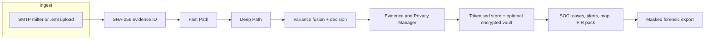

# PhishProof — Complete Final Plan
### SIH26106 · Cyber Cell Forensic Intelligence on the Guardian Engine

**Product name (SIH / UI / pitch):** PhishProof  
**Engine (existing repo):** Guardian AI at `D:\SMTP_NEW_PROJECT`  
**This file is the only SIH source of truth.**  
Do not use `GUARDIAN_AI_LEAN_FINAL.md`, `GUARDIAN_AI_SIH_FINAL.md`, or `PROJECT_OVERVIEW_FINAL (1).md`.  
`Guardian_AI_Final_Execution_Plan.md` is historical Guardian scope — not SIH definition of done.

---

## 1. What PhishProof Is

PhishProof is not “another AI spam filter.”

It is a **forensic investigation workbench** for Cyber Cell, running on the **existing Guardian SMTP gateway** (already ~55% built).

Traditional email security asks: *Is this email malicious?*

PhishProof asks five questions:

1. What evidence says this email is suspicious, and how strong is each signal?
2. Do independent signals **agree**, or do they **conflict**?
3. Where did the **probable originating infrastructure** come from (not “where is the attacker”)?
4. Is this email part of a **campaign** already seen in other complaints?
5. What **court-ready evidence package** does the investigator need — without turning the system into a second copy of the victim’s bank secrets?

**One-line pitch**

> PhishProof does not just detect suspicious emails — it explains the evidence, traces the infrastructure, correlates the campaign, protects victim PII, and knows when it should not trust its own verdict.

---

## 2. Merge Rule (Do Not Start Over)

| Rule | Meaning |
|---|---|
| One codebase | Extend `D:\SMTP_NEW_PROJECT`. No second FastAPI/milter/dashboard. |
| SIH wins conflicts | If a leftover Guardian Tier-1 item fights an SIH requirement, do SIH. |
| Reuse what exists | Gateway, UI, auth, DB, variance fusion, SPF/DKIM/DMARC, SHA-256, models in Lab. |
| After SIH | Same repo can finish ClamAV, DLP, Nginx, SIEM. Those are post-hackathon. |

**Rename:** SIH pitch and dashboard title = **PhishProof**. Internal modules may still say Guardian.

---

## 3. Locked Thesis and Language

- Independent detectors vote. **Confidence = disagreement (variance).** High disagreement → `HUMAN_REVIEW`.
- Fusion score = **evidence consistency**, never “94% probability it is malicious.”
- Origin language: **probable originating infrastructure**, never “attacker location / attacker IP.”
- Device-code and TOAD = **heuristics**, not ML.
- OAuth consent-phishing and AiTM = **mock / roadmap**. Do not advertise as live.
- Customer mail: **analyse in memory, persist the verdict, not the secret.**

---

## 4. What Already Exists (Keep — Do Not Rebuild)

- Postfix + milter, FastAPI, PostgreSQL, Redis, Docker Compose
- JWT + RBAC, Mail Client, SOC shell, Model Lab
- Decision ladder + variance confidence + quarantine + HIGH_RISK / UNCERTAIN queues
- Inbound REJECT on BLOCK / HARD_BLOCK
- SPF / DKIM / DMARC
- SHA-256 content hash (today used for **dedup** — extend into **evidence ID**)
- Credential regex + entropy
- XLM-R / Office / PDF artifacts in Model Lab (must be wired into the **live** path)
- Weighted-mean fusion + boosters (trained XGBoost fusion is **parked** for SIH)

---

## 5. Architecture (Merged)



**Fast Path (< 50 ms):** auth, headers, relay IP, GeoLite2 City+ASN, VPN/TOR/cloud class, URL rules, recon-pixel, impersonation, XGBoost/heuristic phishing features, evidence hash.

**Deep Path (1–3 s):** live XLM-R, PDF/Office models, SVG/ICS, QR/OCR → URL model, cached WHOIS/DNS/MX, ATO baseline, campaign graph, custody events.

**After decision:** Privacy Manager redacts secrets, then persist / alert / case / report.

---

## 6. Complete Feature List

### 6.1 Fast Path

| # | Feature | Action |
|---|---|---|
| 1 | SPF / DKIM / DMARC | Keep / live |
| 2 | Return-Path / Received / Reply-To anomalies | Build |
| 3 | Relay-path → earliest **reliable** IP | Build |
| 4 | MaxMind GeoLite2 City | Build |
| 5 | GeoLite2 ASN + ISP / hosting class | Build |
| 6 | VPN / TOR / botnet / cloud lists | Build |
| 7 | URL regex + lookalike + shortener + CAPTCHA-gate | Build (model if artifact loads) |
| 8 | Recon-pixel detection | Build |
| 9 | Impersonation / Levenshtein + homograph flag | Build |
| 10 | SHA-256 **evidence ID** (not only dedup) | Extend existing hash |

### 6.2 Deep Path

| # | Feature | Action |
|---|---|---|
| 11 | Wire XLM-R + Office + PDF into `engine.py` live path | Must |
| 12 | NLP + heuristics: BEC, device-code, TOAD, invoice drift (pre-seed vendors) | Build |
| 13 | SVG script-smuggling + ICS abuse | Build |
| 14 | QR / OCR → same URL pipeline | Build (replace stub) |
| 15 | WHOIS / DNS / MX **pre-cached** for demo | Build |
| 16 | Behavioral ATO baseline (pre-seed 5–10 mails / sender) | Build |
| 17 | Campaign graph (pre-seed; demo mail joins a node) | Build |

### 6.3 Fusion + decision (existing)

| # | Feature | Action |
|---|---|---|
| 18 | Variance-based confidence | Keep |
| 19 | HARD_BLOCK → … → PASS + HUMAN_REVIEW | Keep |

### 6.4 Evidence, privacy, Cyber Cell (NEW — required)

| # | Feature | Action |
|---|---|---|
| 20 | **Evidence & Privacy Manager** (see §7) | **Build** |
| 21 | Indian PII / secret detector (OTP, last-4, PAN, Aadhaar, card, IFSC+account) | **Build** |
| 22 | Tokenisation + HMAC tokens for campaign linkage | **Build** |
| 23 | Encrypted evidence vault + “Preserve for FIR” | **Build** |
| 24 | Chain-of-custody log | **Build** |
| 25 | PII masking on all exports | **Build** |
| 26 | Retention field (7 / 30 / 90 / custom) | **Build** |
| 27 | Complaint intake → case (victim, amount, bank, date) | **Build** |
| 28 | Searchable case + campaign merge | **Build** |
| 29 | SOC alert banner (HARD_BLOCK / BLOCK) | **Build** |
| 30 | Leaflet map + attribution graph | **Build** |
| 31 | Forensic JSON report (masked) | **Build** |
| 32 | FIR / IT Act notes + 65B checklist | **Build** |
| 33 | ISP / intermediary notice draft | **Build** |
| 34 | Dual-control unlock of raw `.eml` (IO role + custody row) | **Build** |

### 6.5 Keep but do not expand for SIH

Mail Client, Model Lab, JWT/RBAC shell, milter REJECT.

### 6.6 Mock only — do not pitch as live

OAuth consent-phishing, AiTM / session-cookie kits.

---

## 7. Extra System: Evidence & Privacy Manager

This is the **security system** added so victims and Cyber Cell can trust a scan of bank mail.

### 7.1 The problem

Phishers often include **last-4 of an account**, OTPs, or PAN-like text. Detectors **must read** that text. Customers and officers fear a **permanent second copy** of those secrets in our database or a PDF that gets forwarded.

**Wrong fix:** hash the body *before* scanning — models then see garbage; detection dies.  
**Right fix:** scan in memory → persist **tokens and scores** → lock raw mail in a vault only when a case is opened.

### 7.2 Pipeline

```
Full email (worker RAM)
    → All detectors run (unchanged; they still see last-4 / OTP)
    → Secret detector tags spans
    → Tokeniser rewrites body for storage / UI / export
    → HMAC(secret, value) optional for “same last-4 across complaints”
    → Default persist: redacted body + flags + scores + evidence_id
    → Raw .eml: only if investigator clicks Preserve for FIR (encrypted)
    → Every view / export / unlock writes custody_log
```

### 7.3 What to persist

| Data | Default store | If case preserved |
|---|---|---|
| Raw `.eml` | **No** | Encrypted vault |
| SHA-256 of raw | Yes (evidence ID) | Same |
| From / subject | Mask local-part in exports | Same |
| Full body | **No** | Redacted excerpt or vault |
| OTP / last-4 / PAN / card | **Never cleartext** | `[OTP]`, `[ACCT_LAST4]`, or HMAC token |
| Detector scores, geo, ASN, SPF | Yes | Yes |
| Attachments (passbook PDF) | Hash + verdict only | Vault if Preserve |

**HMAC, not raw SHA-256 of last-4:** only 10,000 possible last-4 values; SHA-256 is brute-forceable. Use `HMAC-SHA256(server_key, "4521")`.

### 7.4 Detector evidence rules

Credential / bank-lure findings in JSON must be:

```json
{ "account_last4_mentioned": true, "otp_like_pattern": true }
```

Never:

```json
{ "otp": "839201", "last4": "4521" }
```

### 7.5 Roles (Cyber Cell)

| Role | Sees |
|---|---|
| Operator | Redacted mail, create case, no vault |
| Investigating officer | Redacted + **unlock raw** for this case only (logged) |
| Admin | Users, retention; no silent browse of all vaults |
| Viewer / demo | Dashboard + masked report only |

### 7.6 Why this helps Cyber Cell

- Complaint desk does not leak OTPs into the thana WhatsApp group.
- IO still gets the **original exhibit** for FIR / 65B when they preserve.
- Campaigns can still cluster on HMAC(last-4) without storing digits.
- Matches PS: privacy, retention, masking, chain of custody.

---

## 8. Cyber Cell Workflow (Make It Usable)

These are **recommended and in scope** for SIH (lightweight, high value).

### 8.1 Complaint intake

Victim does not “use a mail client.” They walk in with a forward or file.

- Upload `.eml` / `.msg` / image (QR/OCR)
- Fields: victim mobile, amount lost, bank, date, district
- Auto **case id** e.g. `PHISH-MH-2026-00421`
- One click: analyse → case → acknowledgement

### 8.2 FIR / IT Act helper (not legal advice)

Plain-language block the IO can paste:

- Impersonation → flag 66D / impersonation
- Money + fake bank mail → amount, UPI/UTR if present (masked)
- Origin: ISP/ASN + timestamp IST → “notice this intermediary”
- Evidence hash + custody timeline → 65B checklist

### 8.3 ISP / registrar notice draft

Auto-fill: IP, time, ASN, registrar, evidence hash, redacted headers.  
This is the real next step after the map.

### 8.4 Campaign merge

Search domain / IP / UPI / HMAC token / TOAD phone → **Same gang?** → one campaign report + masked victim list.

### 8.5 Deployment story

On-prem Docker, offline GeoLite2, cached WHOIS for demo.  
Pitch: *mail never leaves the cell LAN.*

### 8.6 Optional (if time)

Bilingual SOC labels (EN + HI). Not a blocker.

---

## 9. Five Demo Cases

| # | Case | Verdict | Shows |
|---|---|---|---|
| 1 | Clean corporate mail | `PASS` | No false panic |
| 2 | Bank lookalike + last-4 lure | `HARD_BLOCK` | Alert, impersonation, **tokens not digits** in report |
| 3 | QR quishing | `BLOCK` | QR → URL model/rules |
| 4 | TOAD / callback, no link | `QUARANTINE` | Heuristic, zero payload |
| 5 | Compromised trusted mailbox | `HUMAN_REVIEW` | SPF/DKIM/DMARC green, baseline red, high variance |

Case 2 must prove privacy: UI says `a/c ending [ACCT_LAST4]`, not `4521`.

---

## 10. Tech Stack (Unchanged Core + Privacy)

```
Frontend        :  React 18, Vite, TypeScript, Leaflet.js, React Force Graph, Axios
Backend         :  FastAPI, Celery or asyncio, Redis, SQLAlchemy, Alembic
Database        :  PostgreSQL
ML / AI         :  XGBoost, scikit-learn, XLM-R / MiniLM, sentence-transformers
Email analysis  :  mailparser, dnspython, dkimpy, oletools, pyzbar, OpenCV, lxml, icalendar, Levenshtein
Geo / intel     :  MaxMind GeoLite2 City+ASN, Firehol, O-X-L, TOR list, cached WHOIS
Privacy         :  hashlib SHA-256, HMAC-SHA256 tokens, Fernet or AES-256 vault, redaction regex
Graph           :  NetworkX
Infra           :  Docker, Docker Compose
```

---

## 11. Build Order

1. Wire live XLM-R / Office / PDF (+ URL model or rules)  
2. QR / OCR  
3. Relay + GeoLite2 + ASN + lists  
4. Impersonation, recon-pixel, TOAD / device-code / invoice  
5. **Privacy Manager + custody + vault + masked report**  
6. Cases, intake, alerts, map, graph  
7. FIR notes + ISP notice draft  
8. Case 5 ATO baseline + five `.eml` fixtures  

---

## 12. Park — Do Not Build for SIH

ClamAV / YARA / pefile · trained XGBoost fusion · outbound DLP enforcement · SIEM HMAC webhooks · Redis rate limit · Nginx/TLS · Celery-only rewrite · Model Lab / Mail Client expansion · Graph/Gmail APIs · live VirusTotal / live WHOIS · Isolation Forest · auto-remediation · honeypot · Red Team · CAPEv2 · steganography · live OAuth/AiTM · “attacker city” · hashing **before** analysis · storing OTPs for “training.”

---

## 13. SIH Definition of Done

Judges can:

1. Upload or send mail through the existing gateway  
2. See Fast Path (auth, geo/ASN, impersonation)  
3. See Deep Path (NLP/attachments/QR/baseline)  
4. See variance fusion and a ladder decision  
5. See a **map of infrastructure**, not “attacker house”  
6. See a high-risk **alert**  
7. Open a **case**, search, see campaign graph  
8. Download a **masked** forensic report with hash + custody  
9. Run Case 5 → protocol pass → `HUMAN_REVIEW`  
10. Open Case 2 and confirm **last-4 / OTP are tokenised** in UI and export  
11. As IO, **Preserve for FIR** and see a custody row for unlock  

If 1–11 work, PhishProof is SIH-complete even if ClamAV, Nginx, DLP, and trained fusion XGBoost are missing.

---

## 14. Final Do / Do-Not

| Do | Do not |
|---|---|
| Continue Guardian repo as PhishProof | Start a new scanner from zero |
| Analyse full mail in RAM | Hash the body then “scan” |
| Persist tokens, scores, infra intel | Store OTP / last-4 / PAN in Postgres or PDF |
| Vault raw mail only on Preserve | Keep every inbox forever in cleartext |
| HMAC for cross-complaint linkage | SHA-256 of 4-digit last-4 |
| Cyber Cell intake + FIR + ISP notice | Pitch as consumer Gmail replacement |
| Lead with fusion + ATO + origin + privacy | Claim 10 revolutionary AI inventions |

---

*End of PhishProof complete final. Implement on `D:\SMTP_NEW_PROJECT`. SIH name: PhishProof.*
